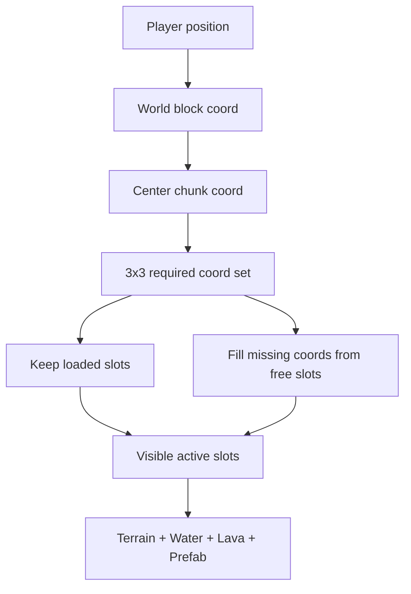

# 3×3 ChunkManager Design Confirmation

## Problem Understanding
The current implementation is `TerrainChunkPingPong`: only an active slot and a standby slot. It works for verifying "pre-generate one target chunk before crossing a boundary", but it can fundamentally only serve one predicted direction. If the player moves diagonally, hugs a corner, turns quickly, or the camera can see a ring of area outside the current chunk, the 2-slot setup can show temporary gaps or synchronous generation pressure.

Assumptions:
- Keep chunk-local rendering: each `ChunkRenderSlot` only draws its own terrain/water/lava/prefab.
- Keep reusing the slot-internal `InstancedMesh` and prefab buckets.
- No infinite-distance caching and no complex LOD; this step only solves the stable loading range around the player.

## Why a 3×3 Active Window
3×3 is the smallest complete neighborhood in 2D movement: "current chunk + four edge neighbors + four corner neighbors".

It is more stable than 2-slot because:
- Horizontal, vertical, and diagonal moves already have their target chunk.
- When the player stands near a chunk corner, none of the four possible directions depends on a temporary prediction.
- When the camera follows the plane, the view usually covers more than the current chunk; the surrounding ring avoids sudden generation at the edges.
- The resource cap is fixed at 9 slots, still simple and controllable.

It is a better next step than 5×5 because:
- 9 chunks already cover the core problem of the "current neighborhood".
- 25 chunks would scale terrain, water, lava, and prefab instance capacity all at once, and there is no performance data yet to support that.
- The 3×3 management logic is enough to expose the lifecycle problems a ChunkManager needs, without introducing LOD, long-distance unloading, async task queues, and other complexity all at once.

## Recommended Approach
Add a new `ChunkManager` to take over `TerrainChunkPingPong`'s responsibilities. `ChunkRenderSlot` stays unchanged and continues as the render container for a single chunk.

Core responsibilities:
- Compute the center chunk from the player position.
- Compute the 3×3 required coords around the center with radius=1.
- Keep slots that are still inside the required coords.
- Take slots from the free slot pool to fill newly added coords.
- Hide slots that fall outside the window and return them to the free pool for reuse.
- Expose APIs similar to the current ones: `bootstrap()`, `update()`, `refreshAOPreview()`, `getDebugMaterials()`, `dispose()`.

Data structures:
- `activeSlots: Map<chunkKey, ChunkRenderSlot>`: the currently visible 3×3 slots.
- `freeSlots: ChunkRenderSlot[]`: reusable slots that are currently hidden.
- `slots: ChunkRenderSlot[]`: 9 fixed slots created up front.
- `centerCoord`: the chunk the player is currently in.

## Slot Spec and Resource Budget
The current config is `chunks.size: 72`, `chunks.halo: 1`, `terrain.cellSize: 0.2`.

Spec for a single `ChunkRenderSlot`:
- Visible logical size: `72 × 72` terrain cells, i.e. `5184` surface sample cells.
- Sampling size: `(72 + halo * 2) × (72 + halo * 2)`, currently `74 × 74`. The halo is only used for sampling height, normal feel, AO, neighbor heights, edge blending, etc.; it is not rendered as visible chunk width.
- World size: `72 * 0.2 = 14.4` world units, so the 3×3 active window covers about `43.2 × 43.2` world units.
- Each slot contains a full set of renderers: terrain, water, lava, prefab placer, heightfield AO.

Fixed caps for the 3×3 active window:
- Slot count: `9`, does not grow with movement.
- Visible surface cells: `9 * 5184 = 46656` cells.
- Total sample maps: `9 * 74 * 74 = 49284` samples.
- Terrain instance count: decided dynamically by `LayeredTerrainBuilder.buildPlacements()`, affected by terrain height, exposed neighbor faces, and water/lava carving. It is not a fixed `cells * maxHeight`, but worst-case cost relates to chunk area and vertically exposed layers.
- Water/lava instance count: grows dynamically per slot, with capacity growing to `1.2`× the current chunk's actual water/lava cell count and reused.
- Prefab instance count: fixed capacity per slot, per prefab bucket — see the next section.

This spec means 3×3 does not just multiply terrain by 9; it multiplies terrain, water, lava, AO, and prefab buckets to at most 9 copies each. So the implementation must avoid creating new renderers on every move; it can only refill the 9 reused slots.

## Prefab Capacity Strategy
The current `PrefabPlacer`'s `prefabCapacity` is the per-category capacity returned by `getPrefabCapacity(prefabEntry)`, used in `fillTransformBucket()` for a single `InstancedMesh` bucket:

```81:86:src/world/prefabs/PrefabPlacer.js
const capacity = this.getPrefabCapacity(prefabEntry)
const instanceCount = Math.min(transforms.length, capacity)
```

Under the chunk architecture, each `ChunkRenderSlot` has its own `PrefabPlacer`. So the actual meaning of `prefabCapacity` should be made explicit:

- It is not a whole-world capacity.
- It is not a capacity shared across the whole 3×3 window.
- It is "the capacity cap for a single prefab category/bucket inside a single slot".

So `prefabCapacity` should not simply be multiplied by 9 just because there are 9 slots. That would inflate the single-window worst-case GPU instance buffer to `9 × new capacity`, which easily becomes excessive.

Recommendation: keep the current values unchanged for now and interpret them as per-slot caps:
- `tree: 128`
- `flora: 512`
- `rock: 256`
- `plant: 256`
- `waterAccent: 32`
- `waterPlant: 64`
- `prop: 64`

Reasons:
- One slot is currently `72 × 72 = 5184` cells, smaller than the old static world of `128 × 128 = 16384` cells.
- The 9 slots cover a larger total area, but each slot is clipped independently; a single slot's bucket does not need to hold the whole window's instances.
- `PrefabPlacer` already has an overflow warning; if a prefab category overflows within a single chunk, tune that category's per-slot cap instead of scaling everything by the active window.

New tests and diagnostics needed:
- Test that `prefabCapacity` is still a per-slot cap under `ChunkManager`.
- Test that each of the 9 slots counts its buckets independently — no sharing, no cross-talk.
- Keep the overflow warning and use it as the basis for later tuning.
- If debugging shows frequent flora overflow, raise only `flora`'s per-slot cap first; do not change `tree/rock/prop`.

## Terrain / Water / Lava Capacity Strategy
Terrain, water, and lava currently have no configured fixed cap; instead the renderer grows during `build()` to `ceil(count * 1.2)` based on the actual instance count and reuses the mesh.

Keep this strategy for 3×3:
- Each slot creates its mesh on first fill based on its own actual instance count.
- When the same slot is later reused for a new coord, if the new count is less than or equal to the historical capacity, only update `mesh.count` and the instance matrix.
- If the new count exceeds the historical capacity, grow only that slot's renderer; the other 8 slots are unaffected.

This is simpler than pre-assigning a global fixed capacity to terrain/water/lava, and it matches the current code better.

One thing to note: 3×3 bootstrap generates 9 chunks at once, so the first-run cost is clearly higher than 2-slot. To keep this version simple, generation stays synchronous; if real browser testing shows stutter, add frame-sliced filling or center-chunk-first priority later.

Data flow:


## Alternative Options Considered
Option A: keep 2-slot ping-pong and add more prefetch directions. This stays cheaper, but quickly becomes edge-case logic: corners need diagonal prefetch, sudden direction changes invalidate the single standby slot, and visibility is still not stable around the player.

Option B: jump to 5×5 or distance-based cache. This is more future-proof, but over-scales the problem before we have profiling data. It also encourages adding eviction policies, prioritization, and async generation too early.

Option C: implement 3×3 fixed active window. This is the simplest complete 2D streaming model, keeps memory bounded, and reuses the slot architecture already built. This is the recommended next step.

## Concrete File Scope
- `src/world/chunks/ChunkManager.js`: new manager, likely replacing `TerrainChunkPingPong` for runtime use.
- `src/world/chunks/chunkCoordinates.js`: add helper for `getChunkWindowCoords(centerCoord, radius)` and stable key ordering.
- `src/world/world.js`: instantiate `ChunkManager` when `chunks.enabled` is true.
- `src/world/WorldConfig.js`: add `chunks.windowRadius: 1` or `chunks.activeWindow: 3`; recommend `windowRadius: 1` because it generalizes naturally while still defaulting to 3×3.
- Tests: add `test/chunkManager.test.js`; keep existing ping-pong tests only if the old class remains.

## Testing Plan
- Unit test 3×3 coord generation, including negative chunk coords.
- Bootstrap loads exactly 9 visible slots around center.
- Moving one chunk reuses overlapping slots and only repopulates the newly exposed strip.
- Moving diagonally reuses the 2×2 overlap and fills the opposite 5 chunks.
- Slot count stays fixed at 9; no extra `ChunkRenderSlot` creation after bootstrap.
- AO preview hides/restores overlays across all visible slots.
- Water/lava/prefab remain chunk-local in managed slots.
