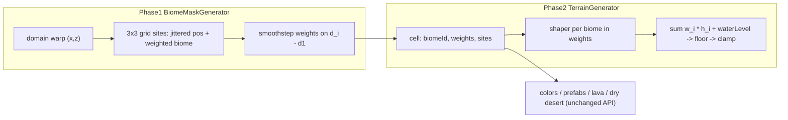

# Procedural Biome Generation + Per-Biome Terrain (Two Phases)

## Problem and Decisions
- Current state: [src/world/biomes/BiomeMaskGenerator.js](src/world/biomes/BiomeMaskGenerator.js) only recognizes the 4 manually configured circular `regions` (radius 120, 400 apart) in [WorldConfig.js](src/world/WorldConfig.js), with everything else defaulting to forest. Since regions never overlap, weights at edges jump directly from `{volcano: 1}` to `{forest: 1}`, and combined with the differences in `heightOffset` / `heightMagnitude`, this creates cliffs. Under the "ecology determines terrain" design, biome distribution is itself an input to terrain, so biome generation must be done correctly first.
- Confirmed decisions:
  - Biome generation uses Jittered Voronoi.
  - `heightOffset` / `heightMagnitude` conflict with the shaper design, so they are deleted outright with no compatibility kept.
  - One plan, executed in two phases.
- Prerequisite: `BiomeCenterSystem` has already been deleted from the workspace, so there is no need to keep fixed region center points.



## Phase 1: Procedural Biome Generation

1. **Rewrite [src/world/biomes/BiomeMaskGenerator.js](src/world/biomes/BiomeMaskGenerator.js)**; the `generate` and `generateForBounds` interfaces stay unchanged:
   - Sites: the world is divided into a grid of cells with side length `cellSize`; grid coordinates `(gx, gz)` are generated using [src/utils/random.js](src/utils/random.js)'s `random01(gx, gz, seed + k)`:
     - Site position: `((gx + 0.5 + (r1 - 0.5) * jitter) * cellSize, ...)`.
     - Site biome: `pickWeighted(table, r3)`.
     - If `originBiome` is set, the grid containing `(0, 0)` is forced to use that biome, preserving the existing setup where "the spawn point is autumnForest".
   - Sampling: first apply a low-frequency domain warp to `(x, z)` (using `createNoise2D(mulberry32(seed + offset))`, with amplitude `warp`) to avoid straight polygonal Voronoi boundaries. Then iterate over the sites in the 3x3 neighborhood of grids, computing each site's distance `d_i` and the minimum distance `d1`.
   - Weights: `w_i = smoothstep(1, 0, (d_i - d1) / blendWidth)`, accumulated per biome id and then normalized. Sites whose distance difference exceeds `blendWidth` naturally get weight 0, so the result is sparse, and it stays continuous at any location including triple junctions — no jumps from top-2 truncation.
   - Output: `{ biomeId, weights, sites: { [biomeId]: { x, z, distance } } }`. In `sites`, each biome keeps only its nearest site, for use by Phase 2 shapers that need a center point, such as the volcano cone.
   - Noise instances are cached per seed and rebuilt when the seed changes, matching how `TerrainGenerator` recreates noise on every generation.
2. **[src/world/WorldConfig.js](src/world/WorldConfig.js)**: delete `biomes.regions`, replacing it with:

```js
biomes: {
  cellSize: 192,
  jitter: 0.6,
  blendWidth: 24,
  warp: { amplitude: 40, scale: 160 },
  originBiome: 'autumnForest',
  table: [
    { id: 'forest', weight: 4 },
    { id: 'autumnForest', weight: 3 },
    { id: 'desert', weight: 2 },
    { id: 'volcano', weight: 1 }
  ]
}
```

3. **[src/debug/panels/BiomePanel.js](src/debug/panels/BiomePanel.js)**: remove the region radius binding, binding `cellSize`, `jitter`, `blendWidth`, `warp.amplitude`, and `table[i].weight` instead.
4. Downstream callers' APIs are unchanged: the `biomeId` read by `placementRules`, `BrickColorResolver`'s jittered coloring, and the `weights.volcano` / `weights.desert` used by Volcano and Desert surface features can all be carried over directly. This phase still keeps the old `heightOffset` / `heightMagnitude` blending, so it can be verified on its own: the biome distribution is correct and boundary weights transition continuously.

## Phase 2: Terrain Shapers

1. **Create [src/world/terrain/heightShapers.js](src/world/terrain/heightShapers.js)**:
   - Move `sampleHeightCurve` and `fbm(noise2D, x, z, noise)` over from `TerrainGenerator` to avoid circular imports; update [test/terrainHeightCurve.test.js](test/terrainHeightCurve.test.js)'s import path accordingly.
   - Unified signature: `shaper({ x, z, noise2D, terrain, params, site }) -> height relative to waterLevel (in layers, floating point)`. Each shaper decides its own height range; there is no generic offset or magnitude.
   - Each shaper offsets its coordinates by a fixed amount to get uncorrelated noise. The `noise` parameter lets each biome override individually; parts not overridden fall back to `config.terrain.noise*` as defaults.
   - `terraced`: `sampleHeightCurve(params.heightCurve, fbm01)`. The curve's h values are written directly as absolute layer counts.
   - `dunes`: low-frequency fbm as the base, layered with ridged noise `1 - |n|` stretched along the `windAngle` direction.
   - `volcano`: use `site.distance` to generate a cone `(1 - d / coneRadius)^power * peak`, carve out a crater within `craterRadius`, layer fbm for roughness, then quantize by `terraceStep`; the part where `d > coneRadius` uses a low terraced base.
2. **[src/world/terrain/TerrainGenerator.js](src/world/terrain/TerrainGenerator.js)**:
   - Store `biomeRegistry`.
   - Change `writeHeightSample` to `h = waterLevel + sum(w_i * shaper_i(...))`, then floor and clamp.
   - Delete the in-class `fbm`.
   - Phase 1's weights are already guaranteed continuous, so patch logic like "fade to forest at edges" is no longer needed.
3. **Remove leftovers from the old design**:
   - [BiomeBlender.js](src/world/biomes/BiomeBlender.js)'s `blendTerrainParam`: its only caller has been removed, so delete it too.
   - In the 4 biome definitions, `terrain.heightOffset` / `terrain.heightMagnitude`: change to `terrain.shape`.
   - [WorldConfig.js](src/world/WorldConfig.js)'s global `terrain.heightCurve`: move it into forest's `shape.heightCurve`, with h values pre-scaled by the original `0.95` factor.
   - [TerrainPanel.js](src/debug/panels/TerrainPanel.js)'s Height curve panel: delete it.
4. **Shape settings per biome**:
   - forest: `terraced`, keeping the existing stepped terrain.
   - autumnForest: `terraced`, with more steps that are each shorter, forming rolling hills.
   - desert: `dunes`.
   - volcano: `volcano`, with `coneRadius` around 70 — it must stay below the order of `cellSize * (1 - jitter) / 2 + blendWidth`, so the cone mostly stays inside its own Voronoi cell.

## Verification
- Phase 1: add [test/biomeMask.test.js](test/biomeMask.test.js), covering the following:
  - Determinism: the same coordinate generated from different chunk origins gives the same result.
  - Each cell's weights sum to 1.
  - Boundary continuity: along a straight line crossing a boundary, the weight difference between adjacent cells stays under a bound.
  - `originBiome` takes effect.
  - Over a large sampling range, each biome's share roughly matches the proportions set in `table`.
  - Also update the `biomes` config in [test/terrainChunkPingPong.test.js](test/terrainChunkPingPong.test.js).
- Phase 2: add [test/heightShapers.test.js](test/heightShapers.test.js), covering:
  - forest's terraced output is equivalent to the old formula.
  - Volcano profile: crater center < crater rim, and crater rim > cone outer edge.
  - Height differences between adjacent cells across biome boundaries stay small.
- After each phase, run `pnpm test`, then check it in practice with `pnpm dev`. In Phase 1, look at the biome distribution and the jittered coloring at boundaries; in Phase 2, look at the dunes, volcano cones, and whether any cliffs remain at boundaries, and check in particular:
  - After the volcano slopes get steeper, whether lava's `maxSlope: 4` and `volcanoRock`'s `maxSlope: 3` noticeably reduce the lava and rock.
  - Whether desert prefabs can be placed on dunes under their `maxSlope` settings.
  - Whether the terrain near the spawn point is still suitable for takeoff.
