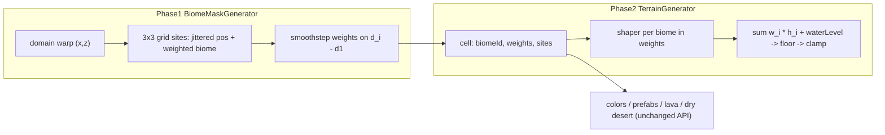

# Procedural Biome Generation + Per-Biome Terrain (Two Phases)

## Problem and Decisions
- Current state: [src/world/biomes/BiomeMaskGenerator.js](src/world/biomes/BiomeMaskGenerator.js) only recognizes the 4 manually configured circular `regions` in [WorldConfig.js](src/world/WorldConfig.js) (radius 120, spaced 400 apart); everything else defaults to forest. Because regions never overlap, edge weights jump straight from `{volcano: 1}` to `{forest: 1}`, and combined with the `heightOffset` / `heightMagnitude` differences, that creates cliffs. Under the "ecology determines terrain" design, biome distribution is itself an input to the terrain, so biome generation has to be done right first.
- Confirmed decisions:
  - Biome generation uses Jittered Voronoi.
  - `heightOffset` / `heightMagnitude` conflict with the shaper design — delete them outright, no compatibility kept.
  - One plan, executed in two phases.
- Prerequisite: `BiomeCenterSystem` has already been deleted from the workspace, so there is no need to keep fixed region center points.



## Phase 1: Procedural Biome Generation

1. **Rewrite [src/world/biomes/BiomeMaskGenerator.js](src/world/biomes/BiomeMaskGenerator.js)**; the `generate` and `generateForBounds` interfaces stay unchanged:
   - Sites: the world is divided into a grid of `cellSize` side length; grid coords `(gx, gz)` use `random01(gx, gz, seed + k)` from [src/utils/random.js](src/utils/random.js) to generate:
     - Site position: `((gx + 0.5 + (r1 - 0.5) * jitter) * cellSize, ...)`.
     - Site biome: `pickWeighted(table, r3)`.
     - When the total weight is greater than 0, entries with weight `0` are never picked, including the `r3 === 0` edge case.
     - If `originBiome` is set, the grid containing `(0, 0)` is forced to use that biome, preserving the existing "spawn point is autumnForest" setup.
   - Sampling: first apply a low-frequency domain warp to `(x, z)` (using `createNoise2D(mulberry32(seed + offset))` with amplitude `warp.amplitude`) to avoid straight Voronoi polygon edges. Traverse the sites in the 3x3 neighboring grids to find each site's distance `d_i` and the minimum distance `d1`, then re-check outer-ring sites using `d1 + blendWidth` and the jitter position range, so large jitter or wide blending never misses a contributing site at a grid switch.
   - Weights: `w_i = smoothstep(1, 0, (d_i - d1) / blendWidth)`, accumulated per biome id and then normalized. Sites whose distance difference exceeds `blendWidth` naturally get weight 0, so the result is sparse and continuous everywhere, including triple junctions — no jumping from top-2 truncation.
   - Output: `{ biomeId, weights, sites: { [biomeId]: { x, z, distance } } }`. In `sites`, each biome keeps only its nearest site, for Phase 2 shapers that need a center point (e.g. the volcano cone).
   - Noise instances are cached per seed and rebuilt when the seed changes, matching how `TerrainGenerator` recreates noise on every generation.
2. **[src/world/WorldConfig.js](src/world/WorldConfig.js)**: delete `biomes.regions`, replaced by:

```js
biomes: {
  cellSize: 192,
  jitter: 0.6,
  blendWidth: 24,
  warp: { amplitude: 40, scale: 160 },
  originBiome: 'autumnForest',
  table: [
    { id: 'forest', weight: 4 },
    { id: 'autumnForest', weight: 3 },
    { id: 'desert', weight: 2 },
    { id: 'volcano', weight: 1 }
  ]
}
```

3. **[src/debug/panels/BiomePanel.js](src/debug/panels/BiomePanel.js)**: remove the region radius bindings; bind `cellSize`, `jitter`, `blendWidth`, `warp.amplitude`, and `table[i].weight` instead.
4. Downstream callers' APIs are unchanged: `biomeId` read by `placementRules`, the jittered coloring in `BrickColorResolver`, and `weights.volcano` / `weights.desert` used by the Volcano and Desert surface features can all carry over directly. This phase still keeps the old `heightOffset` / `heightMagnitude` blending, so it can be verified on its own: biome distribution is correct and boundary weights transition continuously.

## Phase 2: Terrain Shapers

1. **Create [src/world/terrain/heightShapers.js](src/world/terrain/heightShapers.js)**:
   - Move `sampleHeightCurve` and `fbm(noise2D, x, z, noise)` over from `TerrainGenerator` to avoid circular imports; update the import path in [test/terrainHeightCurve.test.js](test/terrainHeightCurve.test.js) accordingly.
   - Unified signature: `shaper({ x, z, noise2D, terrain, params, site }) -> height relative to waterLevel (layers, float)`. Each shaper decides its own height range; there is no generic offset or magnitude.
   - Each shaper offsets its coordinates by a fixed amount to get uncorrelated noise. `shape.noise` can override with `{ scale, octaves, gain, lacunarity }` individually; uncovered parts fall back to `config.terrain.noise*` defaults. `shape.noiseOffset` can override the offset with `{ x, z }`; forest uses zero offset to keep the old terrain equivalent.
   - `terraced`: `sampleHeightCurve(params.heightCurve, fbm01)`. The curve's h values are written directly as absolute layer counts.
   - `dunes`: low-frequency fbm as the base, plus ridged noise `1 - |n|` stretched along the `windAngle` direction.
   - `volcano`: use `site.distance` to build the cone `(1 - d / coneRadius)^power * peak`, carve the crater within `craterRadius`, add fbm for roughness, then quantize the relief above the base by `terraceStep`; roughness fades out toward the outer edge, and the low terraced base is not quantized, so the cone's outer edge joins cleanly.
2. **[src/world/terrain/TerrainGenerator.js](src/world/terrain/TerrainGenerator.js)**:
   - Store `biomeRegistry`.
   - Change `writeHeightSample` to `h = waterLevel + sum(w_i * shaper_i(...))`, then floor and clamp.
   - Delete the in-class `fbm`.
   - Phase 1 weights are already guaranteed continuous, so patch logic like "fade edges toward forest" is no longer needed.
3. **Remove leftovers of the old design**:
   - `blendTerrainParam` in [BiomeBlender.js](src/world/biomes/BiomeBlender.js): its only caller was removed, so delete it too.
   - `terrain.heightOffset` / `terrain.heightMagnitude` in the 4 biome definitions: replaced by `terrain.shape`.
   - The global `terrain.heightCurve` in [WorldConfig.js](src/world/WorldConfig.js): moved into forest's `shape.heightCurve`, with h values pre-converted at the original `0.95`× factor.
   - The Height curve panel in [TerrainPanel.js](src/debug/panels/TerrainPanel.js): delete it.
4. **Shape settings per biome**:
   - forest: `terraced`, keeping the existing terraced terrain.
   - autumnForest: `terraced`; the four large terraces sit at relative-to-water heights of `1 → 9 → 23 → 40`, creating a clear height difference between low land near the water and high platforms. The noise interval width of the second and third platforms is 0.09 (forest is 0.07), slope width stays 0.02, keeping the independent noise offset and autumn-forest coloring.
   - desert: `dunes`.
   - volcano: `volcano`; base terrace heights relative to water are `4 → 8 → 12`, with `peak: 64` and `craterDepth: 40`, so the crater rim sits above the autumn forest's highest terrace while keeping a clear depression. `coneRadius` is 60, less than the default `cellSize * (1 - jitter) / 2 + blendWidth = 62.4`, so the cone stays mostly inside its own Voronoi cell.

## Verification
- Volcano height tuning (2026-10-10): cone `peak` raised from 32 to 64, crater `craterDepth` from 24 to 40, base from `2 → 4 → 6` to `4 → 8 → 12`; radius and slope placement rules unchanged. 29 related tests passed; browser visual check confirmed volcano slopes and lava render normally, with no warnings or errors. Across 8 seeds (24 volcanoes sampled), the highest sampled point rose from 31–34 layers to 58–63 layers; crater centers were 29–38 layers, with no clamping at the 64-layer cap. Comparing the same area on the default seed and seed 42, actual lava cells decreased by less than 1%, rock placeability was roughly unchanged, and cross-biome boundary height-difference distribution stayed roughly the same. The volcano's high ground exceeds the plane's current fixed flight altitude.
- Autumn forest height-difference tuning (2026-10-10): the four platforms changed from `3 → 10 → 17 → 24` to `1 → 9 → 23 → 40`, keeping platform widths, noise offsets, and coloring. 29 related tests passed; browser rendering was normal. Within a 512×512 cell window on the default seed, autumn-forest-dominated cells' height range expanded from 3–28 layers to 3–43 layers; the lowest platform became shoreline, and tree placeability dropped from 55.36% to 39.17%. Near the spawn point, the highest actual brick top in a 33×33 cell area was 2.59, below the plane's center height of 3; the highest platform's actual brick top was 4.205, above the plane's current fixed flight altitude.
- Phase 2 completed (2026-10-10): 11 heightShapers tests passed, covering forest equivalence, noise coverage and offsets, dune directionality, volcano profile and outer-edge joining, post-blend rounding, boundary continuity, and cross-chunk determinism; `pnpm build` passed. Full `pnpm test` totaled 252 tests, 242 passed, with the same 10 pre-existing failures and no new failures. The browser was visually checked at the spawn point, volcano cone/crater/lava, dunes/cacti, and the blend boundaries between neighboring biomes. In same-area sampling on the default seed, the lava candidate slope pass rate rose from 70.55% to 99.95%, volcanoRock placeability from 56.08% to 84.18%, and cactus placeability from 37.25% to 93.06%; existing maxSlope values kept. Near the spawn point, the highest ground top in a 33×33 cell area was about 1.71, below the plane height of 3; slopes and clearance were also re-checked with seeds 1, 42, and 12345.
- Phase 1 completed (2026-10-10): 11 biomeMask tests and 4 terrainChunkPingPong tests passed; `pnpm build` passed. `pnpm test` totaled 241 tests, 231 passed and 10 failed; an isolated re-test against the HEAD baseline confirmed all 10 failures already existed, with no new failures. In `pnpm dev`, the jittered coloring at forest/autumn-forest boundaries and regeneration after editing the Biomes panel were visually checked. `originBiome` keeps the origin-grid site semantics; the default plane spawn point `(64, 64)` is dominated by autumn forest.
- Phase 1: add [test/biomeMask.test.js](test/biomeMask.test.js), covering:
  - Determinism: the same coordinate generated from different chunk origins gives the same result.
  - Each cell's weights sum to 1.
  - Boundary continuity: along a straight line crossing a boundary, neighboring cells' weight difference stays under a cap.
  - `originBiome` takes effect.
  - Over a large sampling area, each biome's share roughly matches the ratios set in `table`.
  - Also update the `biomes` config in [test/terrainChunkPingPong.test.js](test/terrainChunkPingPong.test.js).
- Phase 2: add [test/heightShapers.test.js](test/heightShapers.test.js), covering:
  - forest's terraced output is equivalent to the old formula.
  - Volcano profile: crater center < crater rim, and crater rim > cone outer edge.
  - Height difference between adjacent cells across a biome boundary stays within a small range.
- After each phase, run `pnpm test`, then check with `pnpm dev`. Phase 1 checks biome distribution and the jittered coloring on boundaries; Phase 2 checks dunes, the volcano cone, and whether boundaries still have cliffs, with special attention to:
  - After volcano slopes get steeper, whether lava's `maxSlope: 4` and `volcanoRock`'s `maxSlope: 3` make lava and rocks noticeably scarcer.
  - Whether desert prefabs can sit on dunes under their `maxSlope` settings.
  - Whether the terrain near the spawn point is still suitable for takeoff.
