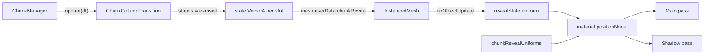

# Migrating Chunk Column Transition Animation to GPU (without changing instanceMatrix)

Status: not yet implemented (draft design, 2026-10-13)

## Goal

Move [`ChunkColumnTransition`](../../../src/world/chunks/ChunkColumnTransition.js)'s column-rise animation from "the CPU rewrites `instanceMatrix` every frame and uploads it" to "the material's `positionNode` computes the displacement in the vertex shader". During the transition, `instanceMatrix` is no longer modified; the CPU only writes one `elapsed` per chunk per frame.

## Current State

- `update()` iterates over all cells every frame to update `progress`, then `applyMesh()` iterates over all instances in the chunk to rewrite 16 floats each, and submits an upload of the whole `instanceMatrix` segment. The cost scales with instance count.
- In practice only the 0-to-1 loading reveal path is used: `ChunkRenderSlot.populate()` calls `resetTransition()` first, then `startLoading()` creates a transition with `initiallyVisible=false`. So per-cell `startProgress`, mid-transition reversal, and similar logic can be deleted in the GPU version.
- Progress depends only on time and the cell:

```text
order    = (reverse ? span - c : c) / span      // c = alongX ? cellX : cellZ, span = chunkSize - 1
t        = saturate((elapsed - order * waveDuration) / columnDuration)
progress = smoothstep(t)
footprint = smoothstep(saturate(progress * 4))
x/z      = anchor + (base - anchor) * footprint
y        = base.y * progress - riseDistance * (1 - progress)
```

Each chunk needs only 4 numbers: `elapsed`, `alongX`, `reverse`, `active`.

Relation to [2026-10-11-prefab-radial-reveal-design.md](2026-10-11-prefab-radial-reveal-design.md): that document removes the prefab radial animation that scales by distance. This design is the chunk-loading column transition; it adds a reveal `positionNode` to the material again, but without introducing distance-driven scaling or fading.

## Design



### 1. Put the displacement in `positionNode`

`NodeMaterial.setupPosition()` runs `instancedMesh(object)` first, then `positionNode` (`node_modules/three/src/materials/nodes/NodeMaterial.js` lines ~796-806), so by then `positionLocal` is already in chunk-local coordinates — exactly matching the computation currently done on the matrix.

The shadow pass reuses `material.positionNode` when there is no `castShadowPositionNode` (`node_modules/three/src/renderers/common/Renderer.js` lines ~3413-3419), so shadows rise along automatically.

### 2. Per-chunk state under shared materials

Materials are held centrally by `WorldMaterials` and shared by all slots. Use `uniform().onObjectUpdate()` to read `object.userData.chunkReveal.state` per render object. By default a uniform belongs to `objectGroup`, one per render object; the callback signature is `callback(frame, self)` (`node_modules/three/src/nodes/core/UniformNode.js` lines ~126-140).

`columnDuration`, `waveDuration`, `riseDistance`, `cellSize`, and `chunkSize` are global shared uniforms.

Trade-off: changing transition parameters in the debug panel immediately affects chunks currently playing, instead of each taking its own snapshot in `start()` as now.

### 3. Anchor point per instance

- terrain, water, lava: instance matrices are pure translations ([`TerrainBrickRenderer`](../../../src/world/bricks/TerrainBrickRenderer.js) uses `setPosition`, [`WaterBrickRenderer`](../../../src/world/bricks/WaterBrickRenderer.js) uses `makeTranslation`, [`LavaBrickRenderer`](../../../src/world/bricks/LavaBrickRenderer.js) uses `setPosition`), so the anchor is `positionLocal.xz - positionGeometry.xz` and no extra data is needed.
- prefab: instance matrices are `T * R * child.matrixWorld`, so the translation component is not the placement anchor. Give each bucket mesh a wrapper geometry: share the source geometry's `index`, attributes, and `groups`, and add an extra `InstancedBufferAttribute('chunkAnchor', 2)` holding the current `userData.chunkColumnPositions` data.

### 4. Bounding box

Expand once when the transition starts and restore once when it ends, same as now. The anchor range on the hidden end uses the whole chunk footprint directly (`[0, chunkSize * cellSize]`, y of `-riseDistance`) instead of iterating per instance.

### Rejected approaches

- Compute shader writing `instanceMatrix`: still fundamentally modifying the matrix, and already explicitly excluded.
- Cloning a material set per slot: material count and warmup cost become 9x.
- Storage buffer or texture storing per-cell progress: progress can be computed analytically, so there is no need to store an extra copy, and per-object binding switches would need handling too.

## TSL Node Sketch

New file `src/world/chunks/chunkRevealNode.js`:

```js
import * as THREE from 'three/webgpu'
import { attribute, float, Fn, mix, positionGeometry, positionLocal, select, smoothstep, uniform, vec3 } from 'three/tsl'

export const chunkRevealUniforms = {
  columnDuration: uniform(0.4),
  waveDuration: uniform(0.65),
  riseDistance: uniform(3),
  cellSize: uniform(1),
  chunkSize: uniform(64),
}

// x: elapsed, y: alongX, z: reverse, w: active
const IDLE = new THREE.Vector4(0, 1, 0, 0)
const revealState = uniform(new THREE.Vector4())
  .onObjectUpdate(({ object }) => object.userData.chunkReveal?.state ?? IDLE)

export function chunkRevealPosition({ anchorFromAttribute = false } = {}) {
  return Fn(() => {
    const u = chunkRevealUniforms
    const p = positionLocal
    const anchor = anchorFromAttribute
      ? attribute('chunkAnchor', 'vec2')
      : p.xz.sub(positionGeometry.xz)
    const cell = anchor.div(u.cellSize).floor().clamp(0, u.chunkSize.sub(1))
    const span = u.chunkSize.sub(1).max(1)
    const column = select(revealState.y.greaterThan(0.5), cell.x, cell.y)
    const order = select(revealState.z.greaterThan(0.5), span.sub(column), column).div(span)
    const t = revealState.x.sub(order.mul(u.waveDuration)).div(u.columnDuration.max(1e-4)).saturate()
    const progress = select(revealState.w.greaterThan(0.5), smoothstep(0, 1, t), float(1))
    const footprint = smoothstep(0, 1, progress.mul(4).saturate())
    const xz = mix(cell.add(0.5).mul(u.cellSize), p.xz, footprint)
    return vec3(xz.x, p.y.mul(progress).sub(u.riseDistance.mul(progress.oneMinus())), xz.y)
  })()
}
```

When progress is 1, the output equals the original position, so no restore is needed after the transition ends.

## Implementation Steps

1. Add `src/world/chunks/chunkRevealNode.js` (the node above).
2. [`src/world/WorldMaterials.js`](../../../src/world/WorldMaterials.js): set `positionNode = chunkRevealPosition()` on `legoMaterial`, `waterMaterial`, and `lavaMaterial`; `previewMaterial` is optional. Don't put it in `createLegoMaterial()`, because the prefab builder also calls that, and prefabs need the attribute version.
3. Prefab materials all use `chunkRevealPosition({ anchorFromAttribute: true })`:
   - [`src/world/prefabs/treeMaterial.js`](../../../src/world/prefabs/treeMaterial.js): swap `MeshPhysicalMaterial` for `MeshPhysicalNodeMaterial`.
   - [`src/world/prefabs/PrefabRegistry.js`](../../../src/world/prefabs/PrefabRegistry.js): before `getVariantAsset()` returns, process each asset only once (both GLTF resources and builder output go through here). Convert plain `Mesh*Material` following `NodeLibrary.fromMaterial()` (find the matching NodeMaterial class by type, copy properties with `for (key in material)`), then set `positionNode`; builder output is already a NodeMaterial, so just overwrite `positionNode`.
   - tint and instanceColor materials are generated by `sourceMaterial.clone()`; `NodeMaterial.copy` copies `positionNode`, so no change is needed.
4. [`src/world/prefabs/PrefabPlacer.js`](../../../src/world/prefabs/PrefabPlacer.js):
   - `getOrCreateMeshBucket`: create the wrapper geometry (share `index`, attributes, `groups`, and bounding volumes; append `chunkAnchor` with length `capacity * 2`).
   - `populateInstancedMesh`: write anchors into `geometry.attributes.chunkAnchor`, set `needsUpdate = true`, and delete `userData.chunkColumnPositions`.
5. [`src/world/prefabs/PrefabPipelineWarmup.js`](../../../src/world/prefabs/PrefabPipelineWarmup.js): `addWarmupMesh` uses the same wrapper geometry so the vertex layout matches runtime.
6. [`src/world/chunks/ChunkColumnTransition.js`](../../../src/world/chunks/ChunkColumnTransition.js): delete `progress`, `startProgress`, `delays`, `baseMatrices`, `applyMesh`, and the matrix restore. Keep:
   - `start(direction, settings)`: compute `alongX` and `reverse` (keeping the existing logic), `state.set(0, alongX, reverse, 1)`, write to the shared uniform, `duration = waveDuration + columnDuration`.
   - `capture(group)`: for each InstancedMesh, set `mesh.userData.chunkReveal = this` and expand the bounding box once.
   - `update(dt)`: `state.x = elapsed += dt`; when `elapsed >= duration`, restore the bounding box, delete `userData.chunkReveal`, and return true.
   - `reset()` and `discard()`: restore the bounding box and delete `userData.chunkReveal`.
7. [`src/world/chunks/ChunkManager.js`](../../../src/world/chunks/ChunkManager.js): set `chunkRevealUniforms.cellSize` and `chunkSize` once in the constructor. [`ChunkRenderSlot`](../../../src/world/chunks/ChunkRenderSlot.js)'s calling pattern (`startLoading`, `updateTransition`, and the supplementary capture in `ensurePrefabsBuilt`) stays mostly unchanged; when a prefab finishes building a few frames late it reads the same `state` and automatically picks up the current progress.

## Gotchas

- Warmup layout: the warmup mesh must use a geometry with `chunkAnchor` and the converted material, otherwise the pipeline vertex layout differs and the first prefab load still causes a compile hitch.
- Don't call `dispose()` on the wrapper geometry: when a geometry is disposed, the WebGPU backend releases all attributes and the index it references, including the parts shared with the source geometry (`node_modules/three/src/renderers/common/Geometries.js` lines ~186-202). Buckets are reused within the slot lifetime; just drop the reference when finally destroying them.
- Normals no longer follow scaling: brick faces are axis-aligned, so there is no visible difference; normals are degenerate when scale is 0.
- During the transition, CPU raycasting gets the final position, not the animated one.
- Prefab GLTF materials in `Resources` are converted in place; if those resources are used elsewhere, confirm the conversion doesn't affect them.

## Edge Cases

- `columnDuration = 0`: divided by `max(1e-4)`, completes immediately.
- `chunkSize = 1`: `span` is 1, `order` is 0.
- `transition.enabled = false`: goes through `resetTransition()`; after deleting `userData`, the shader outputs the original position.
- `debugSpacing`: only changes `slot.group.position`, not chunk-local coordinates.

## Verification

1. `pnpm dev`, open `#debug` and fly; find a terrain mesh through `window.__experience` and confirm `instanceMatrix.version` stays unchanged during the transition.
2. Compare wave direction (X/Z axes, forward and reverse) against the current version, keeping parameters identical.
3. Whether shadows rise with the columns, and whether prefabs that finish building a few frames late stay in sync with the terrain.
4. Whether the first prefab load causes new compile hitches (check warmup coverage).
5. Toggle `transition.enabled` and adjust `debugSpacing`, confirming there is no leftover displacement.
6. `pnpm test` passes (there is currently no test directly covering `ChunkColumnTransition`).
